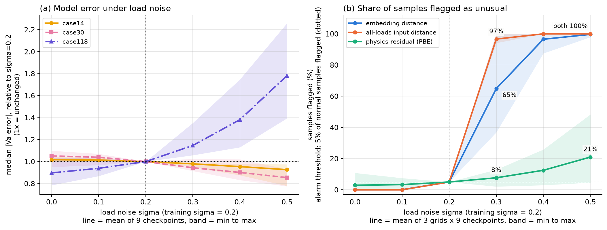
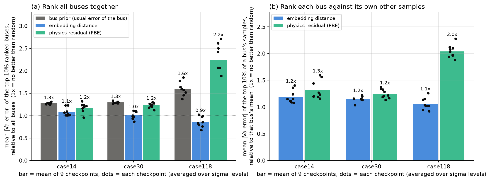
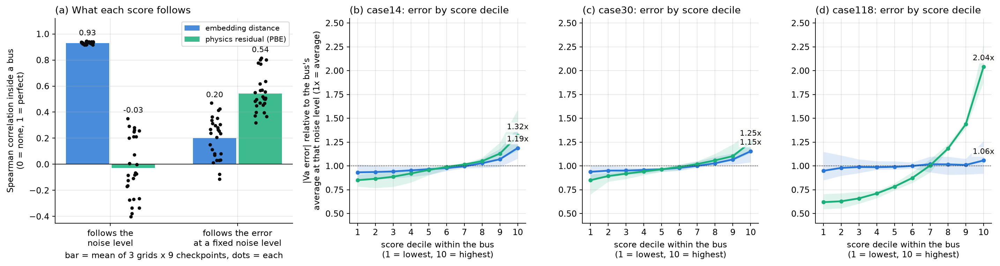
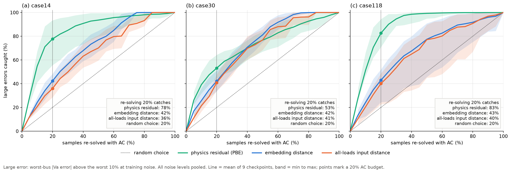

# Can GENCO flag its own errors?

*Testing its power-balance error and embeddings under load noise*

## Summary

I ran the nine published pretrained GENCO power-flow checkpoints on IEEE 14-, 30- and 118-bus grids with increasing per-bus load noise, and asked which of the model's own signals warns that it is wrong.

- **PBE picks the right cases for the AC fallback the GENCO authors propose.** If an AC solver re-solves the 20% of samples with the highest power-balance error (PBE), it catches 83% of the large errors on the 118-bus grid, 78% on the 14-bus grid and 53% on the 30-bus grid. Picking by the embedding distance or by an input-only check catches 36-43%, and random picking 20%.
- **The model is fairly robust to load noise on small grids.** Its voltage-angle error does not grow with noise on the 14- and 30-bus grids (0.93x and 0.85x at the highest noise level), and grows 1.8x on the 118-bus grid.
- **The embeddings shift strongly with noise, but a simple distance on them is not an error warning.** It follows the noise level almost perfectly (correlation 0.93 inside a bus) and the error only weakly (0.20), and an input-only check that sees all the loads detects the noise earlier. The embeddings still carry some error information on the 14- and 30-bus grids (0.25-0.33), so a different way of processing them may extract more.
- **At the level of single buses, PBE points at the large errors on the 118-bus grid** (2.2x the average error on the 10% highest-PBE buses, against 1.6x for simply knowing which buses are usually bad). On the 14- and 30-bus grids it is no better than that static baseline.

## Motivation

GENCO replaces an iterative AC power-flow solver with a neural network. To use it for screening, an operator needs to know when not to trust a prediction. GENCO offers two candidate warning signals without running a solver:

- its **latent embeddings** (the hidden vector of each bus before the output head), and
- its **power-balance error (PBE)**, the residual of the power-flow equations at the predicted solution.

I test both under load noise, a natural out-of-distribution stress, since the checkpoints were trained at one noise level.

**Related work.**
- The [GENCO paper](https://arxiv.org/abs/2608.09921) proposes using power-balance residuals to send critical cases to an AC solver, but does not test this or relate PBE to the true error; load robustness is listed as future work. **I test that proposal under load noise.**
- [Alcántara and Chatzivasileiadis (2026)](https://arxiv.org/abs/2602.07995) add conformal intervals to GridFM v0.2 for N-k screening, calibrated on labelled AC solutions, without PBE or load noise.
- [A 2026 preprint](https://arxiv.org/abs/2610.05959) finds, for other neural power-flow models, that the direction of the voltage error, not only its size, drives the power-balance residual.

## Method

**Noise.** A sample is one operating state of a grid. In each sample, every bus's load is scaled by a random factor in [1 - σ, 1 + σ], for σ = 0 to 0.5. The checkpoints were trained at σ = 0.2, so σ >= 0.3 is extrapolation. Details are under Setup.

**Error.** Absolute voltage-angle error (Va) in degrees on all buses except the slack bus.

**Signals compared.**

| Signal | Definition |
|---|---|
| Embedding distance | Mahalanobis distance of a bus's final-layer embedding to a Gaussian fitted for that bus on a reference set at σ = 0.2 ([Ledoit-Wolf shrinkage](https://doi.org/10.1016/S0047-259X(03)00096-4)). One simple, unsupervised way of reading the embeddings: it measures how unusual a state is, not how wrong the prediction is |
| Power-balance error (PBE) | The residual of the power-flow equations at GENCO's predicted solution, per bus in MVA, as defined in the [GENCO paper](https://arxiv.org/abs/2608.09921) and returned by [gridfm-graphkit](https://github.com/gridfm/gridfm-graphkit) |
| All-loads input distance | Mahalanobis distance of a sample's complete load vector (active and reactive load of every bus). The fair input-only baseline for the embedding, since the embedding is computed from the same inputs |
| Bus prior | Rank buses by their usual error at the training noise level, ignoring the sample. The baseline any error warning has to beat |

**Metrics.**
- *Share flagged:* the share of samples a detector flags as unusual, with the threshold set so that 5% of normal (σ = 0.2) samples are flagged. 5% is the floor.
- *Error of the top 10%:* the mean error of the 10% of buses a score ranks highest, relative to all buses. 1x means no better than picking buses at random. A within-bus version ranks each bus against its own other samples, so bus identity cannot help.
- *What a score follows:* the rank (Spearman) correlation of a score, inside a bus, with the noise level and with the error at a fixed noise level. 0 means no relation, 1 a perfect one.
- *Large errors caught with an AC budget:* a sample has a large error if its worst bus's error is above that of the worst 10% of samples at the training noise level. Samples are ranked by a score (the largest PBE of any bus, the mean embedding distance, or the all-loads input distance) and the highest-ranked share is re-solved with AC. The metric is the share of all large-error samples that end up re-solved. Random picking catches exactly the budget.

Results are the mean over the nine checkpoints, with the min-max in brackets.

## Results



*Figure 1. (a) Median voltage-angle error relative to the training noise level. (b) Share of samples each detector flags as unusual, with the alarm threshold set so that 5% of normal samples are flagged.*

### 1. Accuracy under noise

Median Va error at σ = 0.5 relative to σ = 0.2 (Fig. 1a):

| Grid | Ratio |
|---|---|
| 14-bus | 0.93x (0.78-0.97) |
| 30-bus | 0.85x (0.78-0.93) |
| 118-bus | 1.78x (1.39-2.26) |

On the two small grids the model does not get worse with more load noise. On the 118-bus grid it does, and the size of the effect varies between checkpoints. Larger models are not more robust: the 118-bus ratio is 1.67x for tiny, 2.04x for small and 1.64x for base.

### 2. The embeddings shift, but an input-only detector sees it first

Share of samples flagged at σ = 0.3 (Fig. 1b):

| Grid | Embedding | All-loads input distance | PBE |
|---|---|---|---|
| 14-bus | 49% (43-56) | 95% (94-95) | 8% (4-10) |
| 30-bus | 50% (37-66) | 95% (94-96) | 6% (2-9) |
| 118-bus | 95% (88-100) | 100% | 10% (3-13) |

At σ = 0.5 the embedding flags 99-100% of samples, as does the input distance. In none of the 81 checkpoint-grid-noise combinations at σ >= 0.3 did the embedding flag more samples than the all-loads input distance. The embedding is computed from the inputs, so it cannot know more about the noise than the inputs do; its shift is real but it is not a better noise detector. Detecting the noise is a different question from detecting a wrong prediction, which is tested next. PBE barely reacts to the noise (6-10% flagged at σ = 0.3), which is consistent with the small grids' errors not growing.

### 3. PBE points at the buses with large error, on the larger grid



*Figure 2. Error of the buses each score ranks as most suspicious, relative to all buses (1x = random). Bars are the mean over nine checkpoints, dots are single checkpoints. (a) All buses ranked together. (b) Each bus ranked against its own other samples.*

| Grid | Bus prior | Embedding | PBE | PBE, within bus | Embedding, within bus |
|---|---|---|---|---|---|
| 14-bus | 1.27x | 1.08x | 1.17x | 1.32x | 1.19x |
| 30-bus | 1.30x | 1.01x | 1.23x | 1.25x | 1.15x |
| 118-bus | 1.60x | 0.86x | **2.25x** (1.89-2.72) | **2.04x** (1.88-2.28) | 1.06x |

- **118-bus grid:** PBE ranks the high-error buses at 2.2x, clearly above the bus prior (1.6x), and PBE beats the bus prior in all nine checkpoints (the lowest PBE value, 1.89x, is above the highest bus-prior value, 1.85x). Within a bus it still gets 2.0x, so it carries information about the individual sample, not only about which buses are hard.
- **14- and 30-bus grids:** PBE is below the bus prior (1.17x and 1.23x vs 1.27x and 1.30x). Within a bus it adds a little (1.3x and 1.25x).
- **Embedding distance:** about random on every grid (0.9-1.1x overall). Within a bus there is a small signal on the smaller grids (1.15-1.19x) but none on the 118-bus grid. This holds for the distance score; it does not show that the embeddings carry no error information, only that this score does not extract it.

### 4. The embedding distance follows the noise, PBE follows the error



*Figure 3. (a) Rank correlation of each score with the noise level and with the error at a fixed noise level, inside a bus. Bars are the mean over 3 grids x 9 checkpoints, dots are single grid-checkpoint pairs. (b-d) Error per score decile, each bus compared with its own average at the same noise level (1x = average). Lines are the mean over nine checkpoints, bands the min-max.*

| Grid | Embedding: follows noise | Embedding: follows error | Embedding: top decile | PBE: follows noise | PBE: follows error | PBE: top decile |
|---|---|---|---|---|---|---|
| 14-bus | 0.92 | 0.33 (0.07-0.47) | 1.19x | -0.10 | 0.70 (0.55-0.82) | 1.32x |
| 30-bus | 0.93 | 0.25 (0.15-0.31) | 1.15x | -0.24 | 0.43 (0.32-0.51) | 1.25x |
| 118-bus | 0.94 | 0.02 (-0.11-0.11) | 1.06x | 0.26 | 0.49 (0.37-0.57) | **2.04x** |

- **The two scores answer different questions.** The embedding distance follows the noise level almost perfectly on every grid (0.92-0.94): it measures how unusual the input is. PBE hardly follows the noise level (-0.24 to 0.26) but follows the error at a fixed noise level (0.43-0.70): it measures how wrong the answer is.
- **The embeddings do carry some error information on the small grids.** At a fixed noise level the embedding distance still follows the error with 0.33 (14-bus) and 0.25 (30-bus), and the error rises steadily across its deciles (Fig. 3b-c). PBE is stronger on every grid. On the 118-bus grid the embedding signal disappears (0.02), while PBE's top decile has twice the bus's average error.
- The top-decile values match the within-bus values of part 3, so the two analyses agree.

### 5. Testing the proposed AC fallback



*Figure 4. Share of large errors caught when the highest-ranked samples are re-solved with AC, for each share of samples re-solved. All noise levels are pooled. Lines are the mean over nine checkpoints, bands the min-max; the dotted diagonal is random picking.*

Share of large errors caught, by AC budget:

| Grid | AC budget | PBE | Embedding distance | All-loads input distance | Random |
|---|---|---|---|---|---|
| 14-bus | 10% | 55% (41-67) | 24% | 21% | 10% |
| 14-bus | 20% | **78%** (56-93) | 42% | 36% | 20% |
| 30-bus | 10% | 39% (32-49) | 26% | 22% | 10% |
| 30-bus | 20% | **53%** (44-64) | 42% | 41% | 20% |
| 118-bus | 10% | 51% (46-66) | 24% | 21% | 10% |
| 118-bus | 20% | **83%** (71-94) | 43% | 40% | 20% |

- **PBE is the best choice on every grid.** With a 20% AC budget it catches about twice as many large errors as the embedding distance or the input-only check on the 14- and 118-bus grids.
- **To catch 90% of the large errors**, PBE needs to re-solve 25% of samples on the 118-bus grid, 40% on the 14-bus grid and 75% on the 30-bus grid (means over checkpoints).
- **Why PBE works on the 14-bus grid here but not in part 3:** part 3 asks *which bus* has a large error, where knowing the usually bad buses already helps a lot. The fallback asks *which sample* contains a large error, where that static knowledge cannot help, since every sample has the same buses.
- Large errors make up 12-17% of the pooled samples.

## Setup

**Models.** All nine published checkpoints of `gridfm/genco-pf-datakit` for each grid: tiny, small and base, each with seeds 0, 1 and 42. No training or fine-tuning.

**Data.** Generated with gridfm-datakit from the PGLib benchmark grids and solved with AC power flow. The per-bus noise sits on top of an aggregated load profile, with 300 samples generated per noise level (σ = 0, 0.1, ..., 0.5), of which the 240 in graphkit's test split are evaluated. Nothing else changes: no outages, no line-parameter noise. A separate reference set at σ = 0.2 (480 evaluated of 600) is used to fit the detectors and the bus prior.

**Reproduce.**

```bash
conda activate genco            # needs gridfm-graphkit, gridfm-datakit and the Julia setup from the GENCO explorer notebook
python genco_noise.py           # runs all 9 checkpoints, writes 6 small CSVs per checkpoint to genco_out/clean/<size>_<seed>/
python make_figures.py clean    # writes figures and results_table.csv to genco_out/clean/figures/
```

Settings (grids, noise levels, sample counts, seeds, the 5% alarm rate, the top 10% share and the large-error threshold) are at the top of `genco_noise.py`. Set `PERTURB_GRID = True` to add random N-1 outages and line-parameter noise as in the checkpoints' training data. The generated data and downloaded checkpoints are cached in `genco_data/` and `genco_ckpt/`.

## Conclusion

1. **GENCO can flag its own errors well enough to save most AC solves, and the signal is PBE.** Re-solving the 20% of samples with the highest PBE catches 78-83% of the large errors on the 14- and 118-bus grids, about twice as many as the embedding distance or an input-only check, and 53% on the 30-bus grid. This is a first test of the safeguarded hybrid workflow the GENCO authors propose, and PBE needs no AC solver to compute.
2. **The two signals measure different things.** The embedding distance follows how unusual the input is (correlation 0.93 with the noise level); PBE follows how wrong the answer is (0.54 with the error at a fixed noise level, against -0.03 with the noise level). A distance-based alarm on the embeddings therefore fires on noisy inputs even where the predictions do not get worse, as on the small grids.
3. **This does not make the embeddings useless for judging reliability.** Even this simple distance still follows the error on the 14- and 30-bus grids (0.33 and 0.25 at a fixed noise level). I tested only one way of reading the embeddings: an unsupervised distance to normal states, on the final layer. That measures how unusual an input is, not how wrong the answer is. Other ways of processing them could extract the error information more directly: a probe trained to predict the error, earlier layers or how the embedding changes across GENCO's correction steps, comparison with the most similar reference samples and their known errors, or a combination with PBE.
4. **Any proposed reliability signal needs a bus-level baseline.** Errors differ strongly between buses, so a static "which buses are usually bad" ranking is already 1.3-1.6x. Without it, PBE's 1.2x on the small grids would look like a result.

**Limitations.**
- **Scope.** Load noise only (no outages, line-parameter changes or measurement noise), voltage-angle error only, synthetic data on three benchmark grids, and one model family (the nine checkpoints share a training recipe).
- **Grid dependence.** At bus level PBE beats the static baseline only on the 118-bus grid; the fallback works well on the 14- and 118-bus grids and less on the 30-bus grid. Results vary a lot between checkpoints on the 118-bus grid, and I cannot say how they scale with grid size.
- **The fallback test is simplified.** It ranks a batch rather than applying a fixed PBE threshold to single cases, and its input-only baseline measures how unusual the loads are, not how high (a total-load rule was not tested).
- **One way of reading the embeddings.** Only an unsupervised per-bus distance on the final layer was tested, so the negative result applies to that score, not to the embeddings in general.
- **Lost samples.** At the highest noise level the solver did not converge for a few samples (as few as 232 of 240 on the 30-bus grid), which may slightly favour the model.

## Next steps

1. **N-1 outages.** Rerun with `PERTURB_GRID = True` and test whether PBE still points at the errors under contingencies, the setting GENCO is built for.
2. **Other ways of using the embeddings for reliability.** A probe trained at σ = 0.2 with AC labels to predict the error from the embedding; intermediate layers and the change of the embedding across correction steps; error estimates from the nearest reference samples in embedding space; and a combined score with PBE. Each is compared with PBE and the bus prior using the same metric.
3. **A larger grid** (e.g. the 500-bus GOC case), to see whether PBE's advantage grows with grid size.
4. **Turn the fallback into a rule.** Calibrate a fixed PBE threshold at the training noise level, add a total-load baseline, and measure the wall-clock time saved against running AC on every case.
5. **Measurement noise and voltage-magnitude error**, to widen the scope beyond load noise and voltage angles.

## Resources

**Papers**
- [GENCO: A Unified Neural Solver Embedded in a Development Framework for Steady-State Grid Analysis](https://arxiv.org/abs/2608.09921) (2026). The model studied here, and the proposed PBE-based AC fallback.
- [Trustworthiness Layer for Foundation Models in Power Systems: Application to N-k Contingency Screening](https://arxiv.org/abs/2602.07995) (Alcántara and Chatzivasileiadis, 2026). Conformal prediction intervals for GridFM.
- [Physics-Informed but Not Physics-Consistent: Error Geometry and Subspace Projection for Neural AC Power Flow](https://arxiv.org/abs/2610.05959) (2026). How voltage errors relate to the power-balance residual.
- [A well-conditioned estimator for large-dimensional covariance matrices](https://doi.org/10.1016/S0047-259X(03)00096-4) (Ledoit and Wolf, 2004). The covariance shrinkage used for the distances.

**Code, models and data**
- [gridfm-graphkit](https://github.com/gridfm/gridfm-graphkit). Loads and runs GENCO and returns PBE and the embeddings.
- [gridfm-datakit](https://github.com/gridfm/gridfm-datakit). Generates the AC-solved load-noise data.
- [gridfm/genco-pf-datakit](https://huggingface.co/gridfm/genco-pf-datakit). The pretrained GENCO power-flow checkpoints (nine for each grid used here).
- [PGLib-OPF](https://github.com/power-grid-lib/pglib-opf). The IEEE 14-, 30- and 118-bus benchmark grids (CC BY 4.0).
